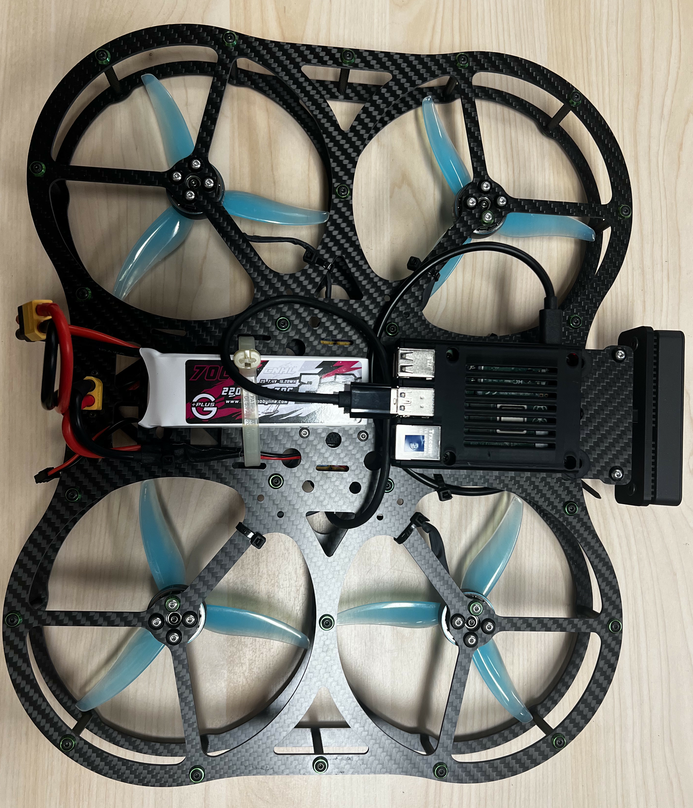
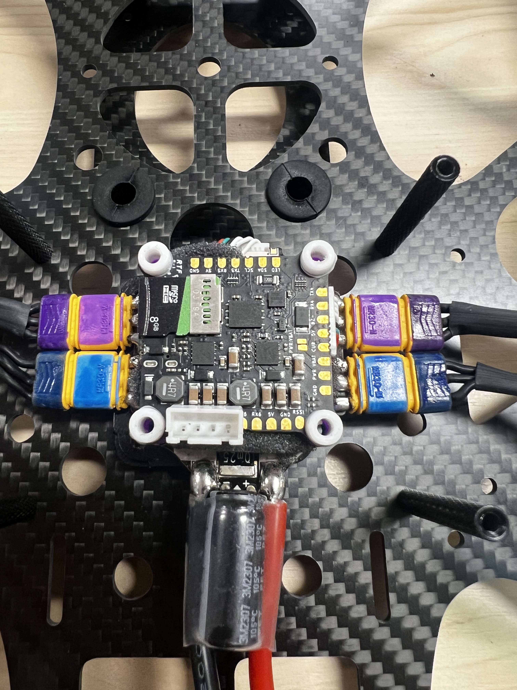
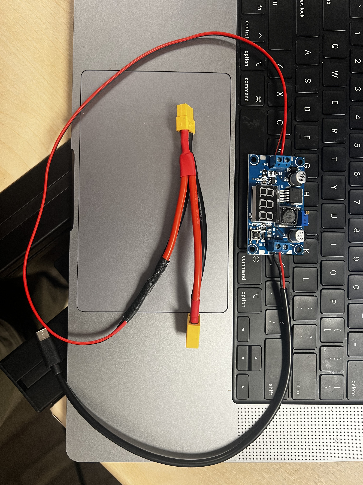
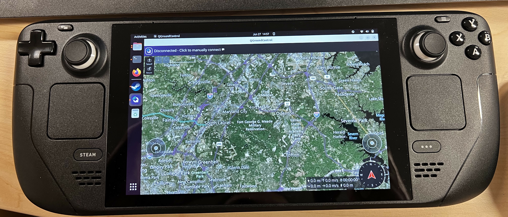
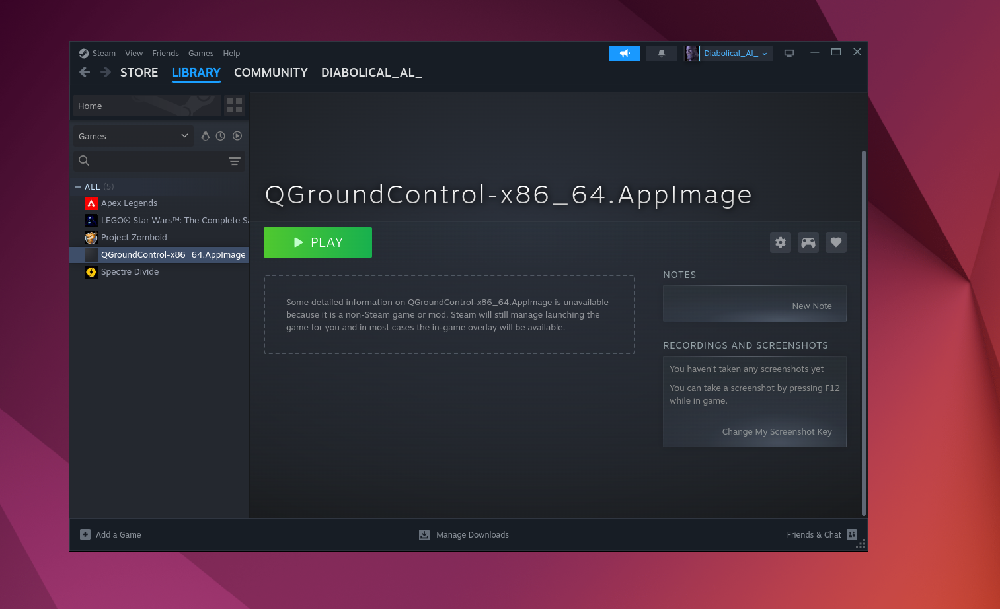
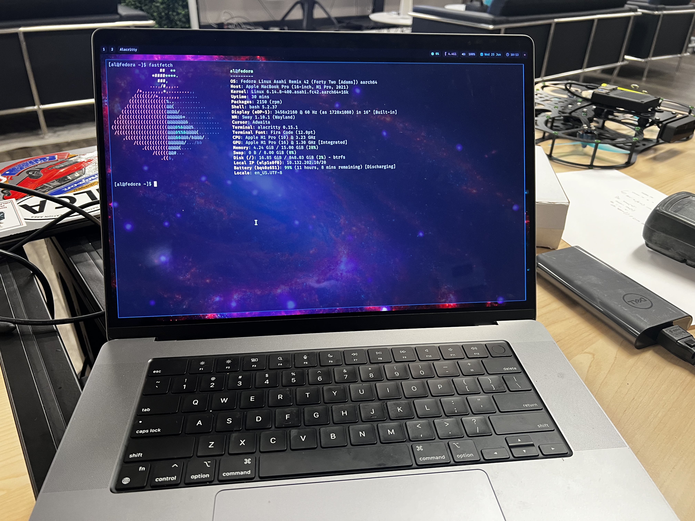
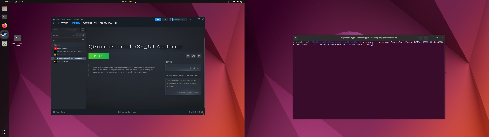
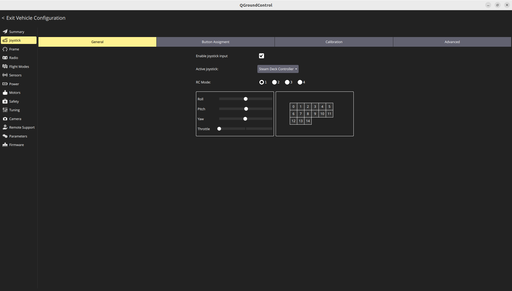
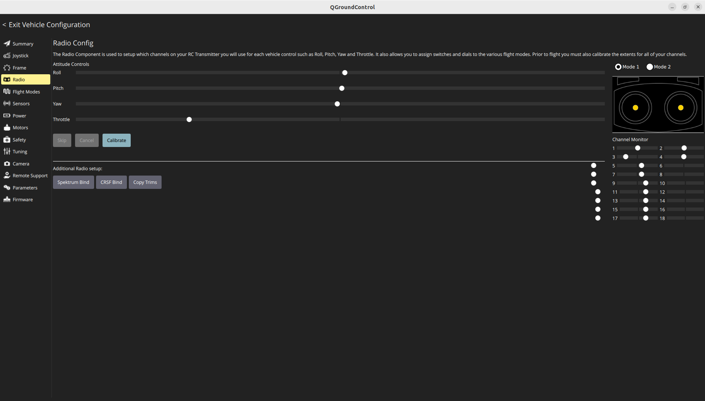

---
format:
  html:
    toc: true
    code-fold: false
title: APL Drone Development
description: Combining Steam Decks with drone technology for autonomous flight on the go
author: Alan Schoenecke
date: 2025-06
---

# APL Drone Development

## Summary of Work While at the JHU APL

I worked at the Johns Hopkins Applied Physics Laboratory from June 10 to June 27. While there, I developed a quadcopter-style drone that demonstrated the ability for both autonomous and manual control from a Steam Deck controller. I established the data pathway between the Raspberry Pi and the Steam Deck, including the ability to use the joysticks in place of a radio controller to pilot the drone.

In addition to the drone's development, I was able to experiment with using Asahi Linux on an Apple Silicon MacBook Pro, as well as begin reverse engineering the ArduPilot firmware for the Beelink F504 board. I feel that the reverse engineering presents a viable future for research, and I would like to continue studying the platform to better understand its vulnerabilities and function.

## Drone Components

I built an autonomous quadcopter-style drone with what I would refer to as a "spread X" shaped frame and four 2306 1755KV motors, making the drone in the 5-6 inch size range. The size metric refers to the propeller size, not the actual drone size itself.

The physical components of the drone are as follows:

1. FC Stack: RADIX2HD
2. Computer: Raspberry Pi 4
3. Battery: CHNL 2200mAh 70C 7.4V Battery
4. Motors: Flight XING2 2306 1755KV Drone Motor
5. Camera: VIA Labs Camera

## First Problems and Beginning Communication with the Drone

Upon assembly, I realized that the drone kit was missing several key components, first of which was the battery. I then performed research on the capabilities of the motors provided by the kit, and ordered the largest battery that I could find that provided the required voltage for the drone's FC stack and motors. The large battery size provided additional range and ensured that the Raspberry Pi could be powered by the same battery as the FC stack assembly.

{width="75%"}

Next, I began tackling the communication problems. The documentation provided with the kit offered little to no actual documentation of how communication between devices and hardware would actually work, so I began researching and finally settled on QGroundControl as the flight software I would use on the computer itself. Before QGroundControl was useful, though, I needed to figure out how to connect the Raspberry Pi to the FC stack, and then the Pi to my computer where QGroundControl itself was running.

When I got the Raspberry Pi, I was unable to get it to connect to the JHU network, so I began by getting the Pi connected to a monitor and setting up some of its local settings. Upon logging into the Pi for the first time, I had my first glimpse at some software produced by whoever had been working on the drone before me. It seemed like a Python-based, homemade attempt at QGroundControl. I connected the Pi to the JHU-Visitor network and then enabled SSH on the Pi so that I could connect to it from my development machine.

After SSHing into the Pi, I used the command `lsusb` to determine the FC stack to be a RADIX2HD board running a version of ArduPilot as its firmware. I then spent time working with and reading the code for the GUI that was developed on the Raspberry Pi, and trying to get the drone to pass the pre-arm checks associated with arming from the Python script. However, I continually ran into the same issues with the ArduPilot firmware itself, which stopped me from being able to arm the drone with the home-built Python script.

After several hours of manipulating the Python script, I researched the firmware more and found the `mavproxy.py` command, which I then installed onto the Pi. This allowed me to run `mavproxy.py`, which would immediately connect the Pi to the FC stack and allowed me to change variables in the firmware, fixing the pre-arm check errors. However, the home-built software was still not playing nicely with the stack or the MAVProxy protocol. So I scrapped it and began using QGroundControl full time instead, as it was a more robust and industry-developed option.

In order to get QGroundControl to see the drone, I needed to route the MAVLink packets into one of the ports that QGroundControl looked at for connections. This led me to use the UDP protocol on port `14550`, which I was able to accomplish by specifying the drone as a device and then using several flags in addition to the `mavproxy.py` command on my computer. This then allowed me to open the QGroundControl window and connect immediately to the drone.

{width="75%"}

The flight stack of the drone uses ArduPilot to connect to the Raspberry Pi for autonomous flight. The Raspberry Pi gives the drone the potential to connect to my computer running QGroundControl and facilitate waypoint-based flight. The Pi also allows for an LLM to be installed onto it in order to allow for autonomous flight capabilities. It also has image recognition software that allows the drone to label and categorize images into larger categories.

I then needed to power the entire thing, Pi and all, from the same battery. Using a buck converter, I was able to assemble a wiring harness that allowed me to power the entire drone with the singular battery, despite the Pi needing a lower voltage than the FC stack. We did this by cutting an XT60 connector and splicing it into a smaller gauge wire, then running that into the converter. We then connected that to a USB-C stub cable and used it to power the Pi.

{width="65%"}

## Using the Steam Deck to Control the Drone via QGroundControl

Until this point I had been connecting to and working with the drone entirely from my laptop running Ubuntu 24.04. However, included with the drone kit was a Steam Deck that seemed to be running Ubuntu. It was locked, and no one had the password, so I used the Ubuntu recovery menu to reset the password. I then began poking around to see if I could make the same processes work from the Steam Deck instead of the computer.

I quickly ran into several major roadblocks. For starters, using the `apt` command in any way resulted in an instant segmentation fault. Checking the package's existence with `dpkg` was also confusing, as it listed the package as installed and existing. I got around this by downloading the `.deb` package from Ubuntu's website and attempting to reinstall it with `dpkg` itself. This failed and gave me another set of errors, which required a different package. I downloaded that package and attempted to install it with `dpkg`, and got a different error that `dpkg` itself was corrupted. This led me to dig through the config files for `dpkg` itself, and realize that they had been completely corrupted.

After this revelation, I was able to recompile `dpkg`, and then build both of my required packages to get `apt` working again. Things went much quicker after that, and I was able to install and start the SSH service on the Deck, and then actually update the entire system to Ubuntu 22.04, which was required to run QGroundControl. I then was able to both SSH into the Pi from the Deck as well as pass back the MAVProxy packets to the Deck, allowing for connection to QGC on the Deck. I was close, but I couldn't get the joysticks to work, which was the entire reason for using the Steam Deck: to bypass the need for a second controller or radio to fly the drone.

{width="100%"}

I began trying to get the joystick input drivers to work with QGC itself, but after a little while began to look for other options. Through some research, I realized that the Steam client could be used to run any program on the computer by loading it as a "non-Steam game." This would allow the Steam client to import the Steam Deck's controls into the application, as the client would run it in the same environment as it would run any video game. This gave me the ability to use the joysticks as the radio controls for the drone.

{width="100%"}

After getting the joysticks to work, I was able to pass all pre-flight checks aside from the GPS requirement, and actually execute a full launch sequence while the drone was taped down on the desk. It is very close to being completed.

## Other Research and Ideas for Continued Development

In between getting cables and other physical supplies I needed for the drone, I was able to work on a few smaller projects. The first was installing Asahi Linux onto a 16-inch M1 Max MacBook Pro, which I did to test the distro as well as using Linux on the ARM-based processor. Asahi uses Fedora 42 as the kernel and GNOME as the stock window manager. Its limitations are that the MacBook Pro cannot use Thunderbolt or USB-C ports for additional displays, or run virtual machines, as the ARM-based architecture is not overly developed with Linux packages. While there may be a way to make QEMU or Virt-Manager work on the ARM-based Fedora install, I was unable to figure it out in the time I had before I was back to working on the drone. If VM support was available, it would greatly improve the usefulness of the MacBook Pro and make the device more worth its large price tag.

{width="100%"}

Secondly, I was able to take some of the Arduino ArduCopter firmware and begin reverse engineering it. I think that this area of vulnerability analysis would be an extremely fruitful area of research, and that better understanding the weaknesses with drone firmware could lead to breakthroughs in drone deterrence for both the private and military sectors.

As for the drone, next steps would include porting the camera into the QGroundControl application, as well as installing a GPS module and getting an antenna or radio to allow for communication without Wi-Fi. This would require some development on the Steam Deck as well, as I am unsure how that platform would work with a different antenna. A mesh network would also be interesting to investigate. I also would love to see what we could do with different scanners or radar on the actual drone, like a LiDAR scanner or infrared capabilities.

## Interfacing With the Drone: Technical Information

The drone uses the following communication stack:

```{mermaid}
flowchart TB
  pc["Ground Station<br/>(Steam Deck with QGroundControl)"]
  pi["Raspberry Pi<br/>(Onboard Computer)"]
  fc["Flight Controller<br/>(RADIX2HD)"]

  pc -->|"UDP / SSH via Wi-Fi<br/>port 14550"| pi
  pi -->|"UART / MAVLink<br/>/dev/ttyACM0"| fc
  fc -->|"Telemetry / Sensor Data"| pi
  pi -->|"Telemetry / MAVLink"| pc
```

### Connecting to the Drone on the Steam Deck in QGroundControl

1. SSH into the drone using the `-X` flag so that an X server is generated for the Raspberry Pi. The Raspberry Pi has its own drone control app that starts on login. Its only usage at this time is to operate the camera, and it does not succeed in arming the drone.
2. Exit the spawned window for controlling the drone.
3. Run the following command to connect to the drone via MAVProxy and forward the data back to the computer at port `14550`, which is how the drone connects to QGroundControl:

   ```bash
   mavproxy.py --master=/dev/<location_of_drone> \
     --baudrate 57600 \
     --out=udp:<pc_ip>:14550
   ```

4. Navigate to the Steam client. Open the client and go to your library.
5. Click the plus button and add the QGroundControl AppImage as a game.
6. Open the controller settings and make sure that it is being run with "Gamepad with Joystick Trackpad" mode enabled. Close the window.
7. Under settings, open properties/controller. Next to the "Override for QGC inputs" section, choose "Enable Steam Input" from the dropdown menu.
8. Run QGroundControl from the Steam launcher.
9. QGroundControl should automatically connect to the drone, as the packets are being forwarded at port `14550`.

{width="100%"}

Once QGroundControl is connected:

1. Inside QGC, enable centered joysticks for throttle control, and then check to see that the inputs are being mapped to QGC from the live menu.
2. Calibrate the radio inputs in the vehicle settings. Do not hold the throttle to the bottom of the bowl when shown. Allow the program to equalize with the stick in its resting position, and it will calibrate without issue.
3. Fly the drone.

{width="75%"}

{width="75%"}

## Lessons Learned

I had a blast on this project and learned a great deal about drones, as well as ways that I could continue developing as both a computer scientist and an engineer. I had never been able to both build and code something before, and I found out that I loved it, as it brought together both my mechanical skill set and my CS abilities. I have found something I am passionate about and will be continuing to build devices, hopefully drones and other robots in the future.

I also learned a ton of Python from working on the MAVLink protocol, as well as a deeper understanding of communication and how signals can be passed over SSH to different programs. I used a great deal of my Linux knowledge and fixed a more complex problem than I had ever come across on the Steam Deck, which I really enjoyed as well. Finally, I found a huge category of things to reverse engineer, and will be looking deeper into drone firmware when I get time. I think that there is so much to see and exploit in cheap drone hardware, and I would love to spend more time actually exploring that area of cybersecurity and vulnerability research.

## Special Thanks

**Joe Duva**, who served as my project mentor for this work. Joe brought me tools from home and consistently assisted me in thinking better about my work, as well as engineering better solutions when I was stuck.

**Will Gray-Roncall**, who ordered me a ton of wiring, batteries, and everything else I needed, as well as allowed me to work on a drone in the first place. I am so glad he had it in the closet.

**Blake**, who got me the MacBook Pro from surplus and walked around with me to see the semiconductor foundries in building 13. Enjoy the Asahi MBP.

<style>
.mermaid {
  display: flex;
  justify-content: center;
  margin: 1.5rem 0;
}
</style>
