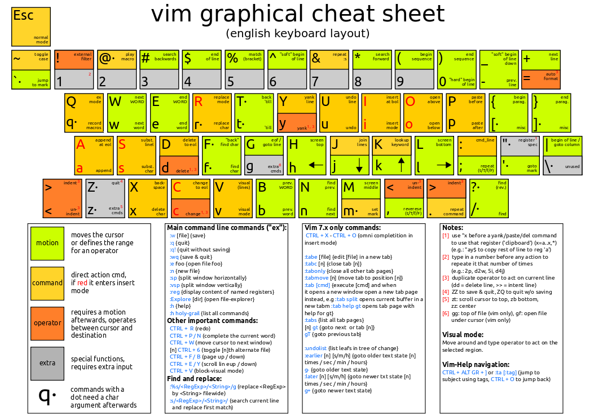
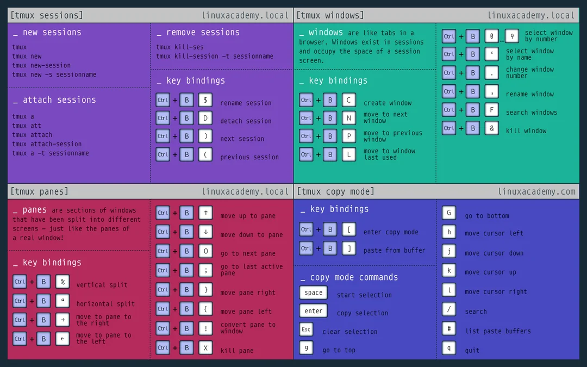

1. Vim, NeoVim

Vim keybindings are significantly faster than clicking with the mouse and keep your hands on the keyboards "home row". You can add them to VS code using the VScodeVim plugin.

- [Vim Cheat Sheet]

{.tools-cheatsheet}

2. TMUX

TMUX is a must as it turns one terminal into many and can allow for better multitasking.

- [TMUX Cheat Sheet]

{.tools-cheatsheet}

3. GDB-GEF

Dynamic Reverse Engineering tool. Adding the GEF to GDB makes it an entirely different experience and greatly improves the base GDB program.

- [GEF by Hugsy](https://github.com/hugsy/gef)
